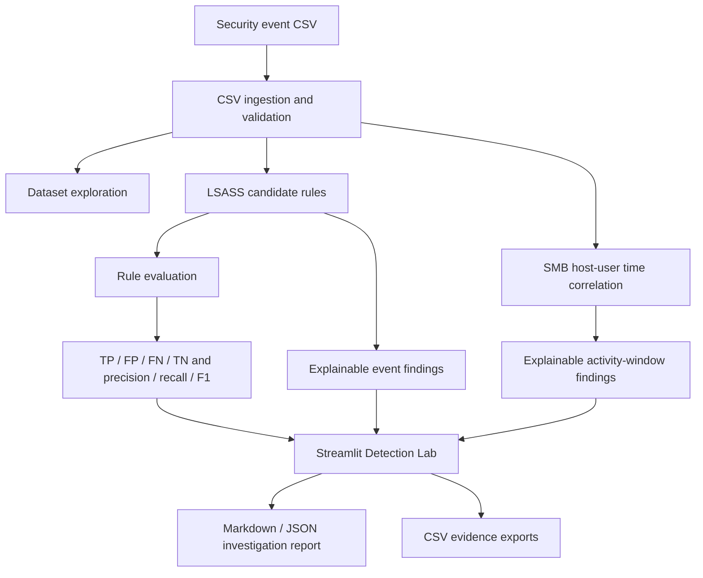

# SENTINELX Architecture

## Components

- **Input:** A user-uploaded CSV or the locally configured `backend/data/attack_scenario.csv` file.
- **Analysis:** Python scripts inspect dataset composition, LSASS events, and SMB activity.
- **Detection evaluation:** Three experimental LSASS rules are compared against labelled `T1003.001` records.
- **Correlation:** SMB events are grouped by host and user and split when the gap between adjacent timestamps exceeds 60 seconds.
- **Explainability:** `backend/investigation.py` records matched conditions, supporting fields, missing evidence, confidence caveats, corroborating signals, and next steps.
- **Presentation:** Streamlit displays the analysis, evidence, and export controls.
- **Reports:** Findings can be exported as Markdown or JSON; selected event tables can be exported as CSV.

## Trust boundaries and limitations

The application is read-only. It does not isolate hosts, block accounts, execute response actions, or confirm compromise. Qualitative evidence assessments are not calibrated probabilities. The Detection Lab evaluates the active dashboard dataset, whether uploaded for the session or loaded from the configured local path.
